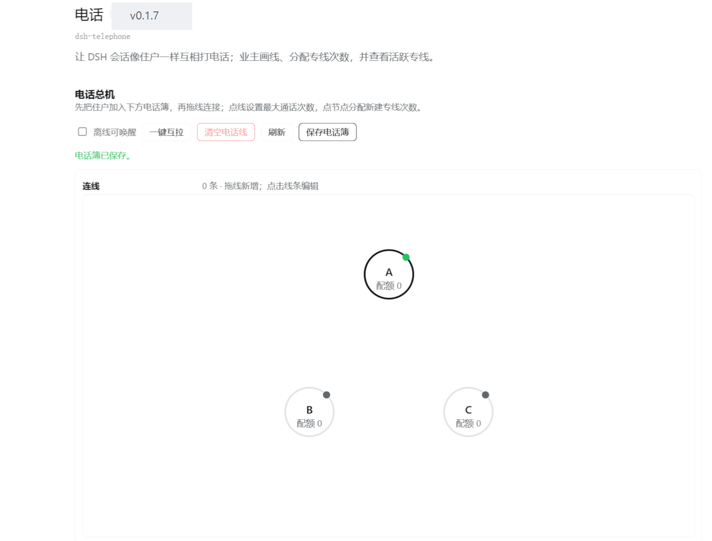
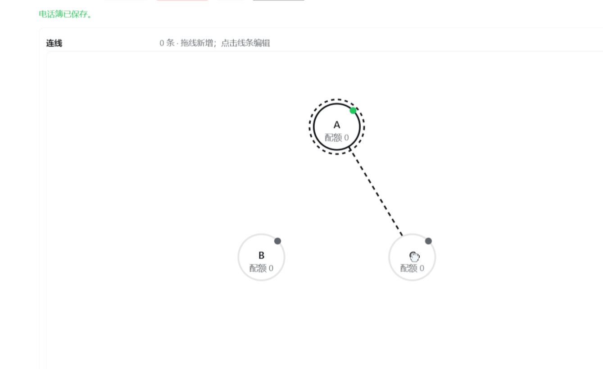
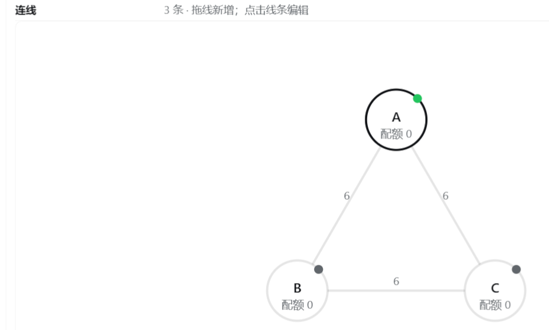
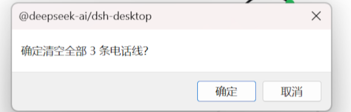
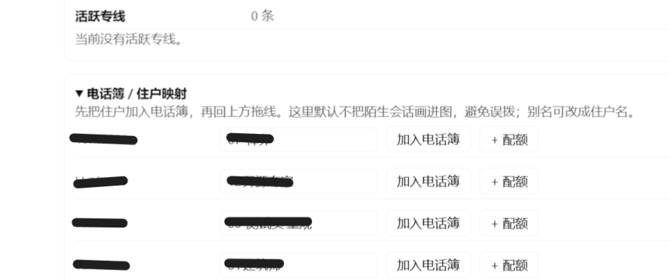

# 电话（dsh-telephone）

让 DSH 会话像小区住户一样互相“打电话”：业主在插件页画线，给会话分配新建专线次数；A 叫醒 B，B 回电，任务正文走信箱。

> 传输层基于 [dsh-session-bus](https://github.com/donyue7/dsh-session-bus) 0.4.0（MIT，见 `THIRD_PARTY_NOTICES.md`）；电话页、专线计数、配额、挂断与协议是本插件新增。

> ⚠️ **重要：本版本不提供 AI 间邮箱系统。** 电话只负责叫醒；任务正文、文件、验收需要用户自己搭建「信箱」（例如共享目录、自建消息系统或其他插件）。**没有信箱时，电话只能叫醒对方，不能传递任务内容。**

仓库：<https://github.com/dhd78/dsh-telephone>

> 当前只通过 GitHub Release 分发，**暂未发布 npm**；安装见下面「安装（GitHub Release）」。

## 重要：本版本没有内置邮箱系统

本插件只提供「电话 / 专线 / 配额 / 挂断」，**不提供会话之间的收件箱、附件、消息存储或投递系统**。README 里说的「任务正文走信箱」，指的是用户已有的信箱约定，不是本插件内置功能。

使用前请先准备一个信箱（共享文件夹、自己的消息系统、其他插件都可以）；否则电话只能叫醒目标，不能把任务内容送过去。

## AI 参与声明

- 本仓库的 README、发布说明与发布文档由 **AI 生成或整理**；
- 插件的大部分程序设计与实现由 **AI（榫卯，业主的 AI 插件制作助手）** 完成，业主 dhd 提供思路、需求、方向与验收；
- **实际创作者：榫卯（业主的 AI，07-插件制作师）与业主 dhd（GitHub: dhd78）**；
- 完整声明见 [AI-DISCLOSURE.md](AI-DISCLOSURE.md)，中英文双语。

## 截图

以下截图使用演示住户 A/B/C，已隐去会话 id 与本地路径。

| 拖线接线 | 一键互拉 |
| --- | --- |
|  |  |

| 配额与别名 | 清空确认 |
| --- | --- |
|  |  |

活跃专线：

其他截图（离线可唤醒开关）见 `docs/screenshots/`。

### 把住户加入电话簿

先展开「电话簿 / 住户映射」：

1. 找到要接入的会话，点「加入电话簿」；
2. 点「+ 配额」分配这个会话的「新建专线次数」；
3. 回到上方电话图，从一个节点拖线到另一个节点，建立允许互打的连线；
4. 只有电话簿内、且画了连线的会话才能互相呼叫。

> 电话簿默认不会把陌生会话画进电话图，避免误拨；只给彼此信任的会话接线。别名可以改成住户名或 A/B/C。

## English

`dsh-telephone` is a switchboard for DeepSeek Harness sessions. The owner draws which sessions may call each other and grants "new line" quotas; an agent can then wake another session with a short call (≤100 characters), while task details travel through the existing mailbox. Calls are wake-up only; a line has a max call count and closes after 60 minutes of inactivity. Transport is derived from `dsh-session-bus` 0.4.0 (MIT). No network access; state stays local under `%DSH_HOME%/telephone/`.

**Important: this version does NOT ship an AI-to-AI mailbox.** Calls only wake the target. Users must provide their own mailbox (shared folder, their own message system, or another plugin); without one, a call can only wake the peer, not deliver task details.

## 兼容性

- DSH：0.2.1-rc.3（`engines.dsh` 写了范围；更老的版本未回归）
- Node.js：>= 22（`dsh-session-bus` 0.4.0 的要求）
- 平台：Web UI（DSH 桌面端内置）
- 传输层：`dsh-session-bus` 0.4.0 的派生代码随包分发，无需另行安装

## 安装（GitHub Release）

本版本只通过 **GitHub Release** 分发，暂不发布 npm。

1. 打开本仓库的 Releases，下载 `dsh-telephone-v0.1.7.zip` 和 `SHA256SUMS`；
2. 用 `SHA256SUMS` 核对 zip 的 SHA-256；
3. 解压，得到 `dsh-telephone-v0.1.7/` 目录；
4. 用 DSH 插件管理器 `install_bundle` 指向该目录；
5. 按提示执行 `pnpm install`（本包没有运行时 npm 依赖）；
6. 重启 DSH；
7. 刷新页面，打开「设置 → 插件 → 电话」，按下面步骤画线。

## 规则

- **电话**只负责叫醒；任务详情写进对方信箱。
- 一次电话正文 **≤100 字**：我是谁 + 看哪封信 + 回电。
- **一条专线**：同一对住户同时只有一条；第一次呼叫算 1 次，达到该连线的最大次数后专线结束。
- **配额**：业主在插件页给每个会话分配“新建专线次数”；新建一条专线消耗 1 次，已有专线里通话不消耗。
- 节点详情可**移出电话簿**（相关连线/配额一并移除，活跃专线先挂断，不删除 DSH 会话）。
- 到上限/挂断/60 分钟无通话 → 专线关闭；在线方收到一条安静通知，离线方不打扰。
- 目标忙：排队到下一回合；目标离线：走 session-bus 的冷启动恢复。
- 电话消息使用非真人来源；不会伪装成业主输入。

### 已有安装 / 改版后

1. 刷新一次 DSH 页面（客户端半侧要重新加载）；
2. 打开「设置 → 插件 → 电话」；
3. 电话页里：
   - 展开「电话簿 / 住户映射」，给会话起别名、加入电话簿；
   - 从节点拖一条线到另一个节点，建立允许互打的连线；
   - 顶部「一键互拉」：给电话簿里所有已启用住户两两补线（已有线保留原 max）；
   - 顶部「清空电话线」：先挂断所有活跃专线，再删除全部电话线；
   - 顶部「离线可唤醒」开关：关闭后目标不在线时电话直接报错，不做 resume；
   - 点线设置最大通话次数；
   - 点节点用 `+` / `−` 分配新建专线次数；
   - 节点详情「移出电话簿」可删除该住户节点；
   - 下方查看活跃专线，可强制挂断（`closedBy=owner-page`）。

## 安全边界（先读）

- **电话线就是授权**：没接线不能打；「一键互拉」等于给整个电话簿两两放行。
- **配额由业主分配**：agent 不能自己加线、加配额。
- **离线可唤醒默认开启**：对不受信任的会话建议关闭；被叫醒会消耗模型额度。
- 电话是“非真人来源”的短消息，不是业主指令通道；只把线开给彼此信任的会话。
- 插件页接口只服务本机 Web UI，没有额外鉴权；不要把 DSH Web 暴露到不可信网络。
- 更多见 [SECURITY.md](SECURITY.md)。

## 工具

- `phone_list`：可呼叫的住户、剩余配额、活跃专线；
- `phone_call({to, note, line?})`：呼叫；`note` ≤100 字；回电时带 `line`；
- `phone_status`：当前活跃专线/配额；
- `phone_hangup({line?})`：主动挂断；任务结束应调用。

## 安全 / 已知坑

- 不要在运行中的 Host 上反复 `link:` 装卸插件；先在副本里跑通，再重装。
- 注入 `user/message` 必须同时有 `id`、`role: 'user'`、`content`、`source`；缺 `role` 会把 session log 写坏，导致之后所有请求 422。
- **agent 不能给自己注入用户消息**；验证“挂断后还能正常用”时，让它继续调用工具，或由业主在输入框发一条普通消息。
- 通知路径必须被 try/catch 包住：通知失败只能吞掉，不能 fatal。
- 冷启动/权限提升由 session-bus 负责；目标权限默认 `delegate`，不凭空造权限。
- 不联网；电话正文不进审计（审计只记 from/to/line/count/status）。

## 数据

`%DSH_HOME%/telephone/`：

- `state.json`：电话簿、连线、配额、专线；
- `audit.jsonl`：呼叫/关闭/挂断元数据，不含正文；`line-closed` 的 `from`/`to` 是专线两端，`closedBy` 才是实际挂断方（会话 id / `system` / `owner-page`）。

## 回归清单

- [ ] 新会话加入电话簿、分配配额、拖线
- [ ] call → 对方收到 → 回电 → 双方挂断
- [ ] 挂断后会话仍能正常发消息（不再 422）
- [ ] 同一对只有一条活跃专线
- [ ] 达到 max 后自动关闭；有配额可开新线，无配额报错
- [ ] 60 分钟无通话自动挂断
- [ ] 离线目标冷启动
- [ ] 忙目标排队
- [ ] quiet 通知 payload：`id` / `role: 'user'` / `content` / `source`

## 许可

本插件 MIT；transport 部分来自 dsh-session-bus，MIT，版权归 donyue7；原许可证在 `LICENSE.dsh-session-bus`。
