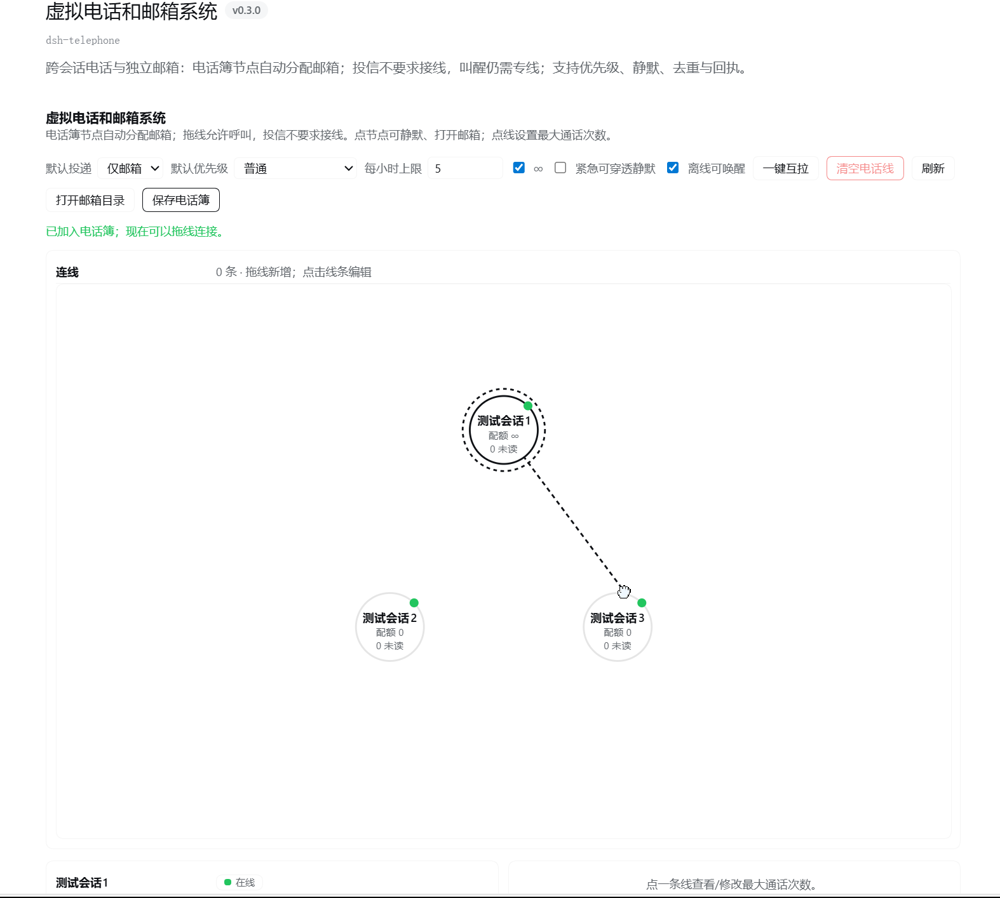
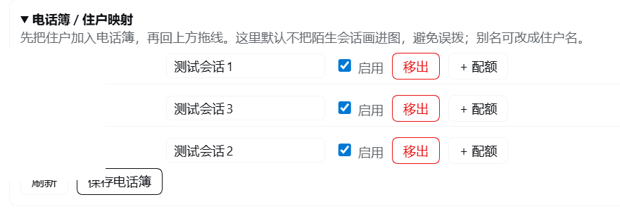
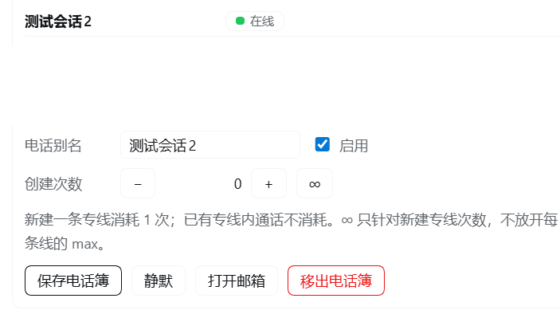
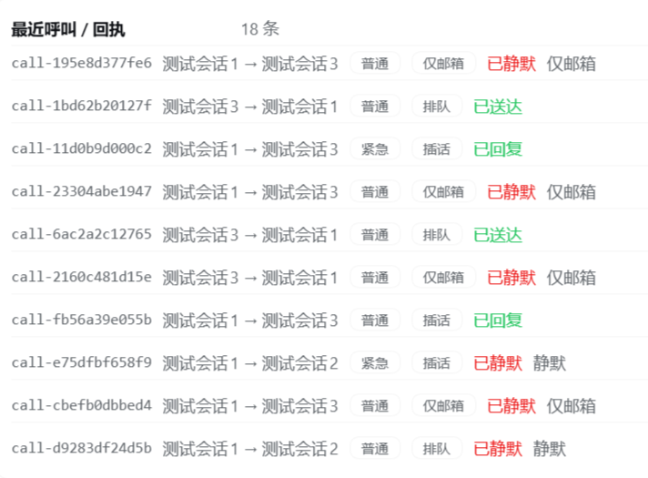
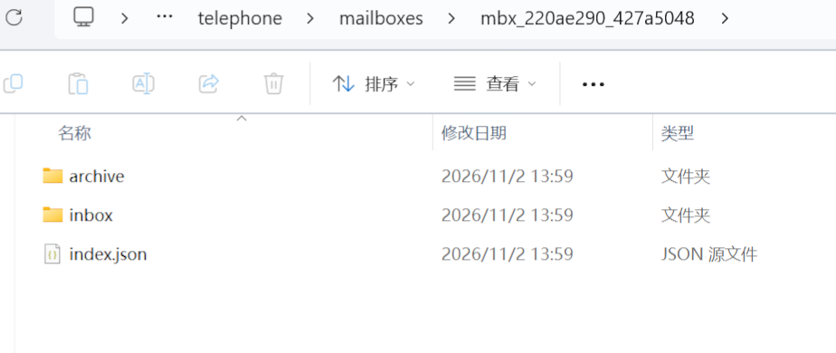
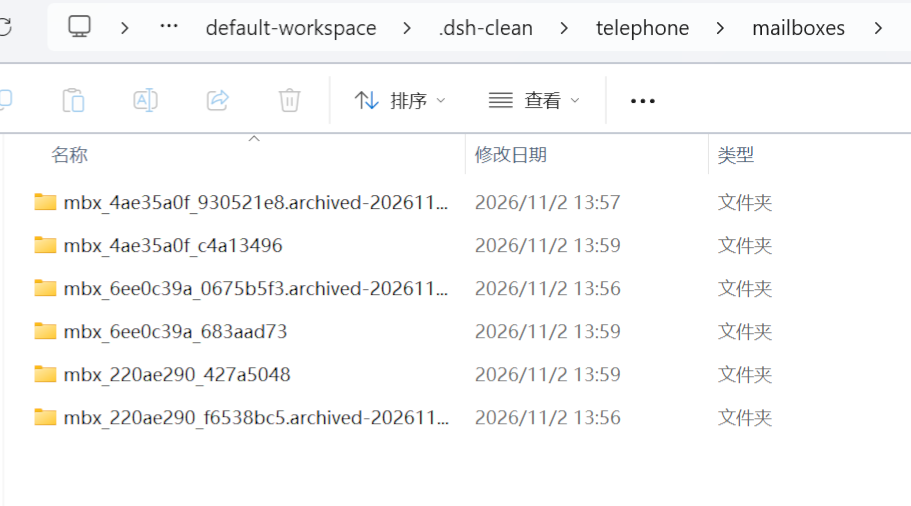

# 虚拟电话和邮箱系统（dsh-telephone 0.3.0）

让 DSH 会话像住户一样互相打电话、投信：业主在插件页画线、给电话簿节点分配邮箱；**电话负责叫醒，邮箱负责正文**。

> 传输层基于 [dsh-session-bus](https://github.com/donyue7/dsh-session-bus) 0.4.0（MIT，见 `THIRD_PARTY_NOTICES.md`）。电话页、独立邮箱、专线计数、配额、优先级/静默/去重/TTL/回执是本插件新增。

仓库：<https://github.com/dhd78/dsh-telephone>

## AI 参与声明

- 本仓库的 README、发布说明、安全说明与发布文档由 **AI 生成或整理**；
- 插件的大部分程序设计与实现由 **AI（榫卯，业主的 AI 插件制作助手）** 完成，业主 dhd 提供思路、需求、方向与验收；
- **实际创作者：榫卯（业主的 AI，07-插件制作师）与业主 dhd（GitHub: dhd78）**；
- 完整声明见 [AI-DISCLOSURE.md](AI-DISCLOSURE.md)，中英文双语。

## 0.3.0 是什么

- **电话**：叫醒一个住户，需要业主画线；
- **邮箱**：给电话簿里的任一节点投信，**不需要接线**；
- **投信 ≠ 叫醒**：信先落邮箱；需要叫醒时再单独 `phone_call`；
- 每个电话簿节点自动分配稳定邮箱：`%DSH_HOME%/telephone/mailboxes/<mailboxId>/`；
- 电话支持 `priority`（urgent/normal/low）、`delivery`（queue/steer/quiet）、`dedupeKey`、`ttlMs`、`letterId`；
- 业主可设全局静默、单节点静默、每目标每小时呼叫上限（1–100，或 **∞** 不按小时限流）；被抑制的呼叫不消耗专线配额；
- 回执：`queued → delivered → read → replied`，以及 `expired / suppressed / failed`；
- 已归档会话不进入电话簿、住户映射、可呼叫/可投信列表；
- 内部包名仍是 `dsh-telephone`，旧工具名 `phone_list / phone_call / phone_status / phone_hangup` 保留，旧 API `/api/telephone-v10` 保留。

## 兼容性

- DSH：`0.2.1-rc.3`（`engines.dsh` 写了范围；更老的版本未回归）
- Node.js：`>= 22`
- 平台：DSH 桌面端内置 Web UI
- 传输层：`dsh-session-bus` 0.4.0 的派生代码随包分发，无需另行安装
- 新增 Host 服务依赖：`workspaceRegistry`（用于归档会话过滤）；DSH 需提供该服务

## 安装

### 方式 A：GitHub Release

1. 打开 <https://github.com/dhd78/dsh-telephone/releases>，下载 `dsh-telephone-v0.3.0.zip` 和 `SHA256SUMS`；
2. 用 `SHA256SUMS` 核对 zip 的 SHA-256；
3. 解压，得到 `dsh-telephone-v0.3.0/` 目录；
4. 用 DSH 插件管理器 `install_bundle` 指向该目录；
5. 按提示执行 `pnpm install`（本包没有运行时 npm 依赖）；
6. 重启 DSH；
7. 刷新页面，打开「设置 → 插件 → 虚拟电话和邮箱系统」。

### 方式 B：npm

**暂未发布。** npm 账号的 2FA/Passkey 无法完成，本次只通过 GitHub Release 分发；上面的方式 A 就是当前安装方式。以后恢复 npm 发布时，会另发版本并在 Release notes 说明。

## 从 0.1.x / 0.2.x 升级

0.3.0 会把 `state.json` 升到 v2，并给旧电话簿节点补 `mailboxId`。

**升级前先备份：**

```powershell
Copy-Item "$env:DSH_HOME\telephone" "$env:DSH_HOME\telephone.backup-0.2" -Recurse
```

然后安装 0.3.0、重启 DSH、刷新页面，检查：

- 旧电话簿节点还在，且自动分配了邮箱；
- 旧的活跃专线/配额/设置还在；
- 新邮箱目录可打开，旧数据没有丢。

> **回滚警告**：0.3.0 写入 `mailboxes/`、`calls`、回执等 v2 字段，旧版代码不识别这些字段。降级前必须备份整个 `%DSH_HOME%/telephone/`；回滚后新邮箱/回执可能不可见或丢失。

## 邮箱与隐私（重要）

邮箱是**本地明文文件**，不是端到端加密信箱：

```text
%DSH_HOME%/telephone/mailboxes/<mailboxId>/
  inbox/<letterId>.md
  archive/
  index.json
```

- Agent 只能读**自己的**邮箱；业主面板可以打开邮箱目录查看；
- 完整信件正文只落 `inbox/<letterId>.md`，不进 `state.json`、`audit.jsonl` 或电话封套；`index.json` 存标题、发件人、**120 字预览**、状态等元数据；
- 任何能读磁盘/备份的人都能读到正文；**不要把 Token、密码、密钥、身份证号写进信件**；
- 删除单封信或整个邮箱目录前先备份；`state.json` 仍有索引，直接删 `.md` 会显示“信件文件不存在”；
- 邮箱目录随电话簿节点归档，不删除 DSH 会话。

## 工具

- `phone_list`：可呼叫住户、可投信住户、邮箱未读、配额与活跃专线；
- `phone_call({to, note, line?, delivery?, priority?, dedupeKey?, ttlMs?, letterId?})`：呼叫/叫醒；
- `phone_status`：当前专线、最近呼叫与回执；
- `phone_hangup({line?})`：挂断专线；
- `phone_mailbox_list`：自己的邮箱未读与最近信件元数据；
- `phone_mailbox_read({letterId})`：读自己的信并标记 read；
- `phone_mailbox_send({to, subject, body, priority?, dedupeKey?, ttlMs?})`：给电话簿节点投信，**不要求接线**。

## 截图

以下截图使用演示会话 1/2/3，已隐去 session id 与本地路径。



| 电话簿 / 住户映射 | 节点详情：静默、配额、打开邮箱 |
| --- | --- |
|  |  |

| 最近呼叫与回执 | 打开邮箱：inbox / archive / index |
| --- | --- |
|  |  |

邮箱根目录（每个电话簿节点一个邮箱）：



> 已归档会话不进入电话簿/可呼叫/可投信列表；这条在回归清单里验证，不再单独放图。

## 规则

- 电话正文 **≤100 字**：我是谁 + 看哪封信 + 回电；任务详情进邮箱。
- 邮箱投递：发送方和收信方都必须在电话簿；**目标有节点即可投信，不要求接线**。
- 投信防刷：同一 sender → 同一 target 每小时最多 **1000 封**；超过返回 `mail-rate-limited`。
- 电话呼叫：双方必须存在一条电话线；没有线只能投信。
- 一条专线同一对住户同时只有一条；第一次呼叫算 1 次，达到该连线的最大次数后专线结束。
- 配额：业主给每个会话分配“新建专线次数”；新建一条消耗 1 次，已有专线里通话不消耗。
- 节点详情可**移出电话簿**（相关连线/配额一并移除，活跃专线先挂断，不删除 DSH 会话）。
- 目标忙：排队到下一回合；目标离线：走 session-bus 的冷启动恢复（业主可关闭）。
- 电话消息使用非真人来源；不会伪装成业主输入。

## 安全边界

- 电话线是呼叫授权；`一键互拉` 等于把电话簿内所有启用会话两两放行，请只给信任的会话使用。
- 插件页 API 只服务本机 DSH Web UI，**没有额外鉴权/Origin 校验**；不要把 DSH Web 暴露到局域网/公网。
- 邮箱明文存储；不要把邮箱当密码管理器或机密文件柜。
- 不联网、不上传；会话被叫醒后执行的任务是否联网，取决于该会话权限，不由本插件控制。

完整威胁模型见 [SECURITY.md](SECURITY.md)。

## 回归清单

- [ ] 新会话加入电话簿，自动分配邮箱
- [ ] 无电话线时 `phone_mailbox_send` 可投信，且不响铃/不唤醒
- [ ] 收信方 `phone_mailbox_list/read` 只读自己邮箱，read 后未读减少
- [ ] `phone_call` 无线报错；有 line 正常
- [ ] queue / steer 投递
- [ ] low/quiet 不响铃，状态 suppressed
- [ ] DND / 静默时段 / 每小时上限
- [ ] dedupeKey 不重复响铃
- [ ] ttl 过期
- [ ] 打开邮箱目录路径校验
- [ ] 挂断/到上限/60 分钟空闲
- [ ] 挂断后会话仍能正常发消息（不再 422）
- [ ] quiet 通知 payload：`id` / `role: 'user'` / `content` / `source`
- [ ] 旧 v1 `state.json` 迁移到 v2，原电话簿/配额/设置保留
- [ ] 已归档会话不出现在电话簿/可呼叫/可投信列表

## English

`dsh-telephone` 0.3.0 is a virtual phone + mailbox system for DeepSeek Harness sessions. Each phonebook node gets a stable local mailbox; mail can be sent without a phone line, while waking a peer still requires an owner-drawn line. Calls support priority, queue/steer/quiet delivery, dedupe, TTL and receipts. Mailbox bodies are stored as plain local files under `%DSH_HOME%/telephone/mailboxes/` and are **not encrypted**; do not put secrets in letters. No network access.

## 许可

本插件 MIT；transport 部分来自 `dsh-session-bus` 0.4.0，MIT，版权归 donyue7；原许可证在 `LICENSE.dsh-session-bus`，第三方说明在 `THIRD_PARTY_NOTICES.md`。AI 参与声明见 `AI-DISCLOSURE.md`。
